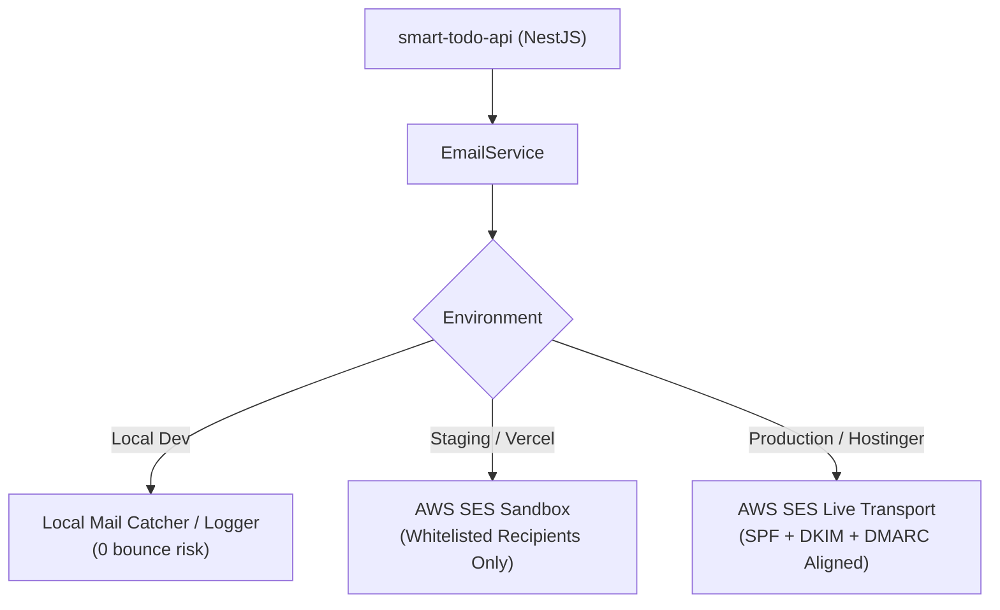

# Epics & Stories Specification: Phase 2 Email Infrastructure & Authentication Flows

| Metadata | Details |
| :--- | :--- |
| **Document ID** | `10-PHASE-2-EMAIL-INFRASTRUCTURE-AND-AUTH-FLOWS` |
| **Version** | `1.0.0` |
| **Status** | Approved Baseline |
| **Shortcut Objective** | [Objective 1571: "Smart Todo Phase 2"](https://app.shortcut.com/marcotello/milestone/1571) |
| **Shortcut Project** | [Project 1052: "Smart Todo"](https://app.shortcut.com/marcotello/project/1052) |
| **Shortcut Epic 11** | [Epic 1572: EPIC-11: AWS SES Transactional Email Infrastructure & Template Engine](https://app.shortcut.com/marcotello/epic/1572) |
| **Shortcut Epic 12** | [Epic 1573: EPIC-12: User Registration Email Verification Flow](https://app.shortcut.com/marcotello/epic/1573) |
| **Shortcut Epic 13** | [Epic 1574: EPIC-13: Self-Service Forgot Password & Reset Flow](https://app.shortcut.com/marcotello/epic/1574) |
| **Shortcut Epic 14** | [Epic 1575: EPIC-14: Two-Factor Authentication (2FA) with Email OTP](https://app.shortcut.com/marcotello/epic/1575) |

---

## 1. Overview & Architecture Strategy

Phase 2 establishes robust transactional email delivery powered by Amazon Simple Email Service (SES) and implements critical account security workflows:
1. **AWS SES Infrastructure:** Domain identity registration, Cloudflare DNS alignment (DKIM, SPF, DMARC), and NestJS client abstraction with multi-environment safety.
2. **Post-Registration Email Verification:** Single-use 24-hour verification token dispatch, verification landing route, and unverified account notification.
3. **Self-Service Forgot Password:** Timing-attack safe password reset request, 1-hour secure tokens, password strength feedback, and global session revocation.
4. **Two-Factor Authentication (2FA):** 6-digit numeric OTP delivery to verified email, 10-minute TTL, 5-attempt brute-force protection, segmented auto-advancing input UI, and pre-auth JWT scoping.

---

## 2. Multi-Environment Email Transport Architecture

---

## 3. EPIC-11: AWS SES Transactional Email Infrastructure & Template Engine

* **Shortcut Epic:** [Epic 1572](https://app.shortcut.com/marcotello/epic/1572)

### Stories Breakdown

#### [STORY-11.1](https://app.shortcut.com/marcotello/story/1576): AWS SES Domain Identity Registration & IAM Setup
* **Type:** Chore / Cloud
* **Description:** Register the sending domain identity in AWS SES, enable Easy DKIM, and create isolated IAM credentials.
* **Tasks:**
  - [ ] Register domain identity in AWS SES.
  - [ ] Generate 3 Easy DKIM CNAME tokens.
  - [ ] Create IAM policy with `ses:SendEmail` and `ses:SendRawEmail` permissions.
  - [ ] Generate isolated API keys for Staging and Production.
  - [ ] Add verified test email addresses in AWS SES Sandbox mode.

#### [STORY-11.2](https://app.shortcut.com/marcotello/story/1577): Cloudflare DNS Configuration (DKIM, SPF & DMARC)
* **Type:** Chore / DNS
* **Description:** Publish email authentication records in Cloudflare to verify domain ownership and ensure deliverability.
* **Tasks:**
  - [ ] Add the 3 DKIM CNAME records generated by AWS SES into Cloudflare DNS.
  - [ ] Ensure Proxy status is set to **DNS Only (Grey Cloud)** for all DKIM CNAMEs.
  - [ ] Add SPF TXT record at apex (`@`): `v=spf1 include:amazonses.com ~all`.
  - [ ] Add DMARC TXT record at `_dmarc`: `v=DMARC1; p=none; sp=none;`.
  - [ ] Monitor AWS SES Console until Domain Status and DKIM Status turn Verified.

#### [STORY-11.3](https://app.shortcut.com/marcotello/story/1578): NestJS EmailModule & AWS SES Client Integration
* **Type:** Feature / Backend
* **Description:** Build the core NestJS email service wrapping `@aws-sdk/client-ses` with multi-environment routing.
* **Tasks:**
  - [ ] Install `@aws-sdk/client-ses` in `smart-todo-api`.
  - [ ] Add `EmailConfig` and validation DTOs in `ConfigModule`.
  - [ ] Implement `EmailService` with multi-environment delivery (Local, Staging sandbox, Production SES).
  - [ ] Unit tests with mocked `SESClient` verifying retry policies and transport switching.

#### [STORY-11.4](https://app.shortcut.com/marcotello/story/1579): Transactional HTML/MJML Email Template Engine
* **Type:** Feature / Templates
* **Description:** Implement responsive email template renderer aligning with Smart Todo design tokens.
* **Tasks:**
  - [ ] Build responsive base email template (brand header, content card, security disclaimer footer).
  - [ ] Build reusable components: call-to-action button, 6-digit OTP chip, expiration disclaimer.
  - [ ] Implement template rendering service with variable interpolation and HTML sanitization.
  - [ ] Unit tests for template rendering and XSS protection.

#### [STORY-11.5](https://app.shortcut.com/marcotello/story/1580): Delivery Telemetry & Bounce/Throttle Guarding
* **Type:** Feature / Reliability
* **Description:** Handle SES rate limits and log delivery telemetry to protect sender reputation.
* **Tasks:**
  - [ ] Handle SES throttling (`LimitExceededException` / `TooManyRequestsException`) with exponential backoff.
  - [ ] Implement structured logging for bounce and complaint error categorization.
  - [ ] Unit tests for error handling and fallback behaviors.

---

## 4. EPIC-12: User Registration Email Verification Flow

* **Shortcut Epic:** [Epic 1573](https://app.shortcut.com/marcotello/epic/1573)

### Stories Breakdown

#### [STORY-12.1](https://app.shortcut.com/marcotello/story/1581): Verification Token Model & Registration Dispatch
* **Type:** Feature / Backend
* **Description:** Prisma schema migration and backend token generation for email verification.
* **Tasks:**
  - [ ] Prisma schema update: Add `isEmailVerified` (boolean) and `emailVerifiedAt` (DateTime?) to `User`.
  - [ ] Add `EmailVerificationToken` table (token hash, expiresAt 24h, createdAt).
  - [ ] Update `AuthService.register` to generate 32-byte hex token, store SHA-256 hash, and trigger verification email.
  - [ ] Unit tests for token generation, hashing, and registration hooks.

#### [STORY-12.2](https://app.shortcut.com/marcotello/story/1582): Email Verification & Resend API Endpoints
* **Type:** Feature / Backend
* **Description:** Implement verification token consumption and rate-limited resend endpoints.
* **Tasks:**
  - [ ] Implement `POST /api/v1/auth/verify-email` validating token hash and setting `isEmailVerified = true`.
  - [ ] Implement `POST /api/v1/auth/resend-verification` with 60-second cooldown rate limit.
  - [ ] Unit tests for expired tokens, invalid tokens, and throttling.

#### [STORY-12.3](https://app.shortcut.com/marcotello/story/1583): Frontend Verification Landing Page & Header Banner UI
* **Type:** Feature / Frontend
* **Description:** Scaffold and implement `/verify-email` route and unverified account reminder banner.
* **Tasks:**
  - [ ] Scaffold `src/app/features/auth/verify-email/` following 9-folder structure.
  - [ ] Implement `VerifyEmailPageComponent` reading `?token=...` with loading and confirmation states.
  - [ ] Add dismissible unverified banner in `MainLayout` with resend trigger.
  - [ ] Unit tests for component and store states.

#### [STORY-12.4](https://app.shortcut.com/marcotello/story/1584): Email Verification Automated Quality Gate & E2E Tests
* **Type:** Feature / QA
* **Description:** Automated testing suite for registration email verification flow.
* **Tasks:**
  - [ ] Frontend Vitest unit tests for verification page and stores.
  - [ ] Playwright E2E spec (`tests/e2e/tests/01-auth/email-verification.spec.ts`).
  - [ ] Verify token consumption, redirect, and invalid/expired error handling.

---

## 5. EPIC-13: Self-Service Forgot Password & Reset Flow

* **Shortcut Epic:** [Epic 1574](https://app.shortcut.com/marcotello/epic/1574)

### Stories Breakdown

#### [STORY-13.1](https://app.shortcut.com/marcotello/story/1585): Password Reset Token Model & Request API (Timing-Attack Safe)
* **Type:** Feature / Backend
* **Description:** Implement secure forgot-password request endpoint with constant-time response protection.
* **Tasks:**
  - [ ] Prisma schema update: Add `PasswordResetToken` table (token hash, userId, expiresAt 1h, createdAt).
  - [ ] Implement `POST /api/v1/auth/forgot-password` with generic HTTP 200 response (timing-attack defense).
  - [ ] Dispatch password reset email with secure action link if user exists.
  - [ ] Unit tests verifying constant-time behavior and token hashing.

#### [STORY-13.2](https://app.shortcut.com/marcotello/story/1586): Password Reset Endpoint & Session Invalidation
* **Type:** Feature / Backend
* **Description:** Implement password reset execution and force-revoke active user sessions.
* **Tasks:**
  - [ ] Implement `POST /api/v1/auth/reset-password`: validate token, hash new password with Argon2id, consume token.
  - [ ] Revoke all existing refresh tokens in the database to terminate any active attacker sessions.
  - [ ] Unit tests for password updates, expired tokens, and session invalidation.

#### [STORY-13.3](https://app.shortcut.com/marcotello/story/1587): Frontend Forgot Password & Reset Password UI Views
* **Type:** Feature / Frontend
* **Description:** Implement `/forgot-password` and `/reset-password` Angular pages with Spartan UI.
* **Tasks:**
  - [ ] Implement `/forgot-password` view with email validation and confirmation feedback.
  - [ ] Implement `/reset-password` form reading `?token=...` with live password strength indicator.
  - [ ] Unit tests for both views, form validation, and store states.

#### [STORY-13.4](https://app.shortcut.com/marcotello/story/1588): Password Reset Automated Quality Gate & E2E Tests
* **Type:** Feature / QA
* **Description:** Automated testing suite for forgot/reset password flow.
* **Tasks:**
  - [ ] Frontend Vitest unit tests for components and stores.
  - [ ] Playwright E2E spec (`tests/e2e/tests/01-auth/password-reset.spec.ts`).
  - [ ] Verify reset request, token consumption, old password rejection, and new password login.

---

## 6. EPIC-14: Two-Factor Authentication (2FA) with Email OTP

* **Shortcut Epic:** [Epic 1575](https://app.shortcut.com/marcotello/epic/1575)

### Stories Breakdown

#### [STORY-14.1](https://app.shortcut.com/marcotello/story/1589): Two-Factor Code Model & OTP Generation Service
* **Type:** Feature / Backend
* **Description:** Implement 6-digit numeric OTP generation and hashing service.
* **Tasks:**
  - [ ] Prisma schema update: Add `TwoFactorCode` table (codeHash, userId, attempts, expiresAt 10m, createdAt).
  - [ ] Implement `TwoFactorService`: cryptographically random 6-digit OTP (`100000`–`999999`).
  - [ ] Hash code with Argon2/SHA-256 and dispatch email with prominent 6-digit chip.
  - [ ] Unit tests for OTP entropy and hashing.

#### [STORY-14.2](https://app.shortcut.com/marcotello/story/1590): Backend 2FA Authentication Lifecycle & Route Guarding
* **Type:** Feature / Backend
* **Description:** Implement pre-auth token scoping, OTP verification endpoint, and lockout rules.
* **Tasks:**
  - [ ] Update `AuthService.login` to issue scoped `preAuthToken` (10m TTL) when 2FA is required.
  - [ ] Implement `POST /api/v1/auth/verify-2fa` with 5-attempt brute-force threshold and token rotation.
  - [ ] Implement `POST /api/v1/auth/resend-2fa` with 60-second cooldown timer.
  - [ ] Unit tests for lockout thresholds, token rotation, and invalid codes.

#### [STORY-14.3](https://app.shortcut.com/marcotello/story/1591): Frontend 2FA Verification Page & Segmented Input UI (/verify)
* **Type:** Feature / Frontend
* **Description:** Implement `/verify` route with 6-box auto-advancing segmented input and guard.
* **Tasks:**
  - [ ] Implement `/verify` route: 6 segmented auto-advancing single-digit boxes with backspace navigation.
  - [ ] Support clipboard paste distribution across boxes and 60-second countdown timer.
  - [ ] Implement `twoFactorPendingGuard` redirecting to `/login` if `preAuthToken` is absent.
  - [ ] Unit tests for auto-advance, backspace, clipboard paste, and form submission.

#### [STORY-14.4](https://app.shortcut.com/marcotello/story/1592): 2FA Automated Quality Gate & E2E Tests
* **Type:** Feature / QA
* **Description:** Automated testing suite for 2FA email OTP flow.
* **Tasks:**
  - [ ] Frontend Vitest unit tests for component, store, and guard.
  - [ ] Playwright E2E spec (`tests/e2e/tests/01-auth/two-factor.spec.ts`).
  - [ ] Verify successful 2FA login, invalid OTP error banners, attempt decrement counter, and 5th-attempt lockout.
